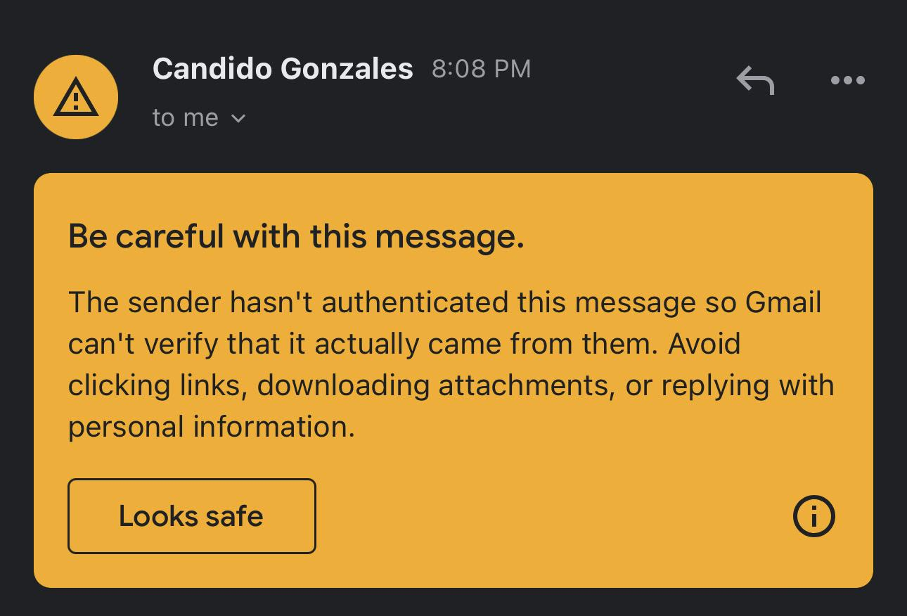
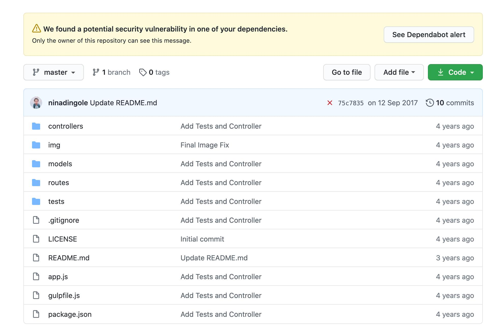
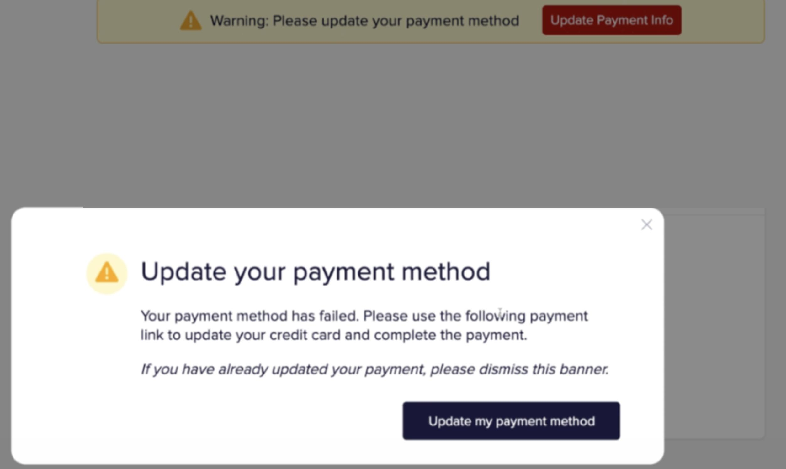

# Alert

**An alert is a visually prominent message that draws attention to important information, a change in status, a potential problem, or an action the user needs to take.**

Unlike a toast, an inline alert generally remains visible as part of the
interface. Unlike an alert dialog, it doesn't block the user's workflow.

- Security and account warnings
- Failed payments or interrupted services
- Confirmation of successful operations
- Important system information
- Required actions or configuration changes

## Considerations

- **Severity**: Distinguish informational, success, warning, and error states
- **Colour**: Reinforce meaning using text and icons; never depend on colour alone
- **Placement**: Put contextual messages near the relevant content or action
- **Message**: Explain what happened, why it matters, and what to do next
- **Persistence**: Keep unresolved problems visible until they are no longer relevant
- **Actions**: Offer a direct, descriptive action when users can resolve the issue
- **Dismissal**: Avoid dismissing critical warnings without a way to recover them
- **Accessibility**: Announce new urgent messages appropriately without interrupting unnecessarily

## Accessibility

A visually styled `Alert` component is not automatically equivalent to the ARIA `alert` role.

- `role="alert"` is intended for important, time-sensitive messages that should be announced immediately.
- `role="status"` or a polite live region is usually more appropriate for routine success messages.
- A warning already visible when the page loads doesn't necessarily need live announcement semantics.
- Avoid placing interactive controls inside the element carrying `role="alert"`; structure actionable alerts so the controls remain independently accessible.

The distinction matters because excessive assertive announcements can be disruptive for screen-reader users.

## Examples

### Gmail

Gmail warning for a sender whose identity could not be authenticated, shared in Google's Workspace community.

Contextual placement is crucial. A security warning is most useful at the moment someone is about to interact with potentially unsafe content.

- The yellow background makes the warning stand out from the surrounding email.
- The message identifies the risk and explains what behaviour to avoid.
- A secondary action allows the recipient to indicate that the email is safe.
- The alert appears immediately alongside the content it concerns.

### GitHub

Earlier GitHub repository interface showing a Dependabot vulnerability warning. 

Alerts can act as entry points to resolution workflows. They don't always need to contain the complete explanation.

- The alert is placed prominently above the repository contents.
- Yellow communicates caution rather than necessarily an immediate failure.
- The message identifies a dependency-security problem.
- An action directs the user to additional details.

### Stamped

Stamped dashboard showing a payment-method warning and an accompanying billing modal.

Actionable alerts should explain the problem and offer a clear path to
resolution, particularly when the problem may affect continued service.

- The dashboard banner communicates an unresolved billing problem.
- The red action button provides a direct path to updating payment information.
- The warning remains relevant until the underlying problem is addressed.
- A separate modal provides more detailed guidance; the banner itself is the
  alert pattern being examined.