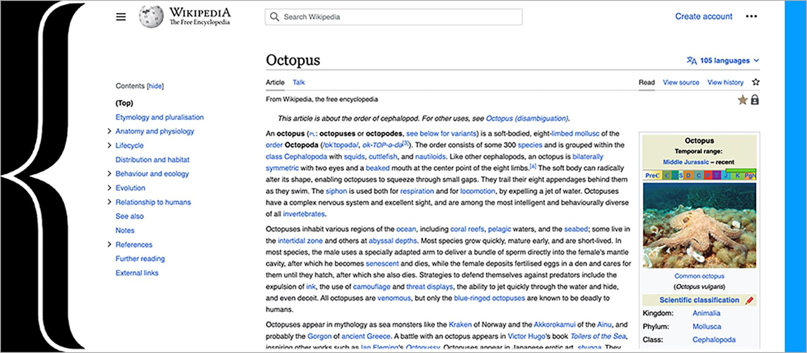
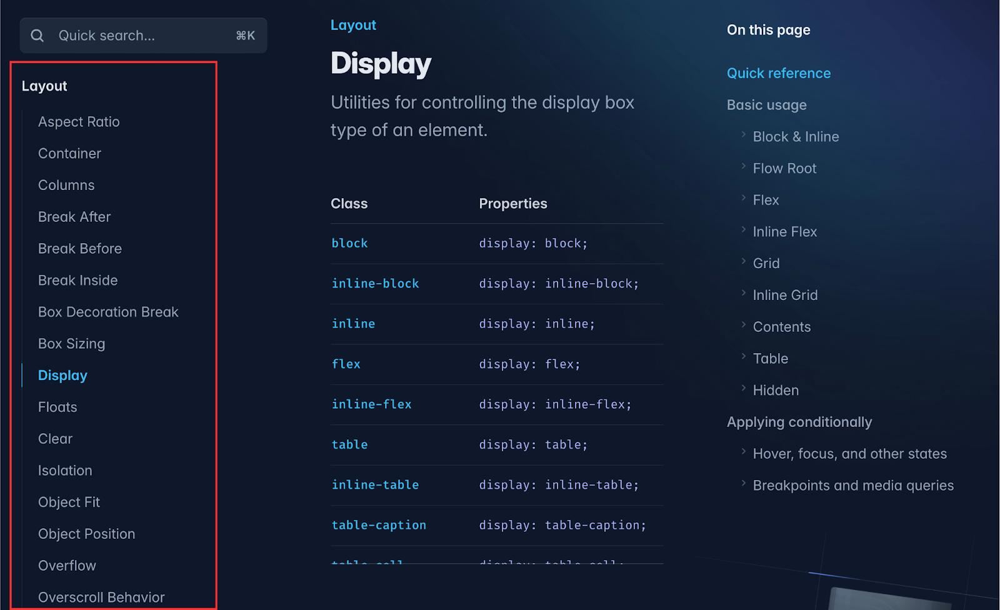
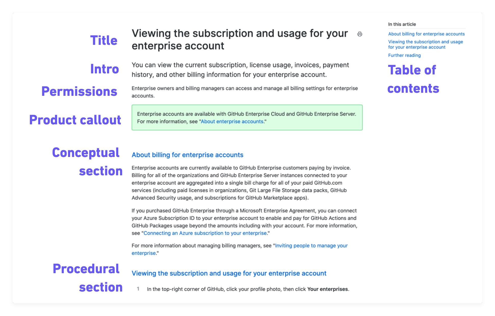

# Anchor

**An Anchor component provides navigation between sections of the same page, typically through a table of contents.**

- Table of contents (TOC)
- Scrollspy navigation
- Section navigation
- On-this-page navigation
- In-page navigation

Unlike a basic collection of anchor links, an advanced Anchor component can automatically highlight the section currently visible as the user scrolls.

## Examples

### Wikipedia

Real Wikipedia desktop interface, showing the table of contents on the left.

Wikipedia provides a persistent article outline with nested headings, making long articles easier to navigate.

Readers can jump between sections and understand where the information fits within the article's structure.

### Tailwind

Real screenshot of the Tailwind CSS documentation, showing section links in the
right sidebar.

It separates global navigation from local navigation, reducing the effort required to move through complex documentation.

Tailwind CSS uses a three-column documentation layout:

- Left: navigation between documentation pages.
- Centre: the current documentation page.
- Right: links to sections within that page.

### GitHub Docs

Annotated screenshot from GitHub's official documentation, showing its article table of contents.

GitHub Docs provides section links within individual articles, including support for navigating longer procedural and reference content.

Why it works: Users can find specific instructions without scanning the entire article.

## Variants

- **Vertical**: Section links arranged vertically, usually in a sidebar         
- **Horizontal**: Section links displayed in a horizontal row                     
- **Sticky**: Navigation remains visible while scrolling                      
- **Scrollspy**: Automatically highlights the currently visible section          
- **Nested**: Hierarchical links corresponding to nested headings             
- **Collapsible**: Sections or the entire navigation can be expanded and collapsed 

## Considerations

- **Indicator**: Clearly distinguish the section currently in view.
- **Offsets**: Ensure navigating to a heading doesn't hide it behind a sticky header.
- **URL**: Use meaningful links such as `#installation` so sections can be bookmarked and shared.
- **Accessibility**: Prefer semantic navigation and real links, supporting keyboard and browser history behaviour.
- **Responsive** behaviour: Consider collapsing a lengthy sidebar into a dropdown or expandable table of contents on mobile.
- **Accuracy**: Avoid rapidly changing the active item when adjacent sections briefly intersect the viewport.
