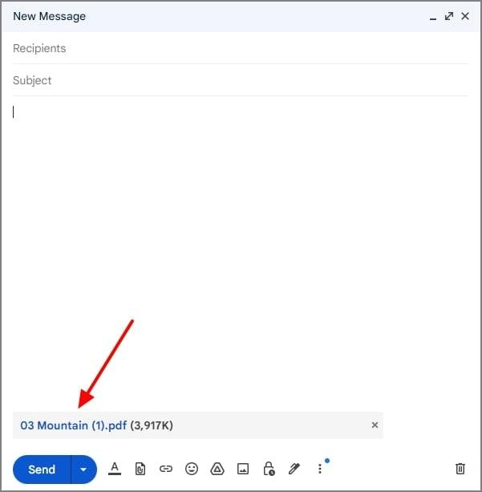
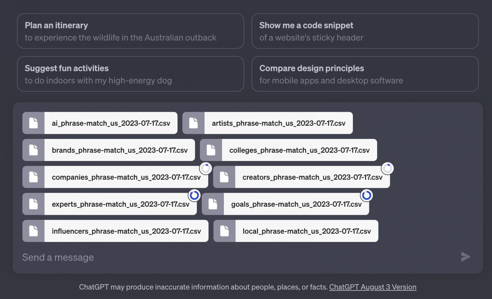

# Attachments

An attachment is a UI element representing a file associated with a message, document, task, or other piece of content.

It typically displays a filename, file type, size, icon or thumbnail, and relevant actions.

- Email attachments
- Files shared in conversations
- Documents uploaded to AI assistants
- Task and issue attachments
- Uploaded images and screenshots
- File previews and download links

## Examples

### Gmail

Gmail's email composer with a PDF attachment, from a Wondershare tutorial.

The main purpose of a pre-send attachment is verification. Users need confidence that they've selected the correct file before submitting it.

- The PDF is represented as a compact horizontal element.
- The filename and size help the sender verify the selected file.
- The attachment remains visible before the email is sent.
- A removal control lets users correct mistakes without abandoning the message.

### Slack

A design-review PDF shared within a Slack conversation, from Slack's official blog.

Slack supports previews for many file types and allows shared files to be discovered through conversations and its file browser.

After a file has been shared, the attachment becomes a content object rather
than merely an upload indicator. Previews and surrounding conversation provide
useful context.

- The file is presented within the message that introduced it.
- A visual preview communicates the document's content.
- The filename helps users identify the resource.
- Colleagues can discuss and react to the attachment in context.

### ChatGPT

An earlier ChatGPT interface displaying several CSV attachments, published by Habr.

In interfaces where users attach several documents, each attachment needs its own identity and state. One file failing should not make it impossible to understand the status of the others.

- Multiple files appear as distinct objects associated with one conversation.
- Compact representations make several attachments manageable.
- Individual file labels differentiate otherwise similar documents.
- Loading indicators communicate that some files are still being processed.

## States

### Lifecycle

An attachment may pass through several optional states (some of these might be skipped).

1. Selected: The file has been chosen but upload hasn't started.
2. Uploading:  The file is transferring. Progress may be displayed.
3. Processing: The transfer is complete, but preview generation or other processing continues.
4. Completed: The attachment is ready for its intended use.

Note that in some cases the "Selected" is the final state, when the file is
uploaded only as part of a larger submission.

### Failure

Uploading or processing can fail at different stages. Users need an explanation and recovery option.

## Considerations

- Identification: Display a recognisable filename and file type                                
- Metadata: Include file size when it helps users recognise or assess the attachment     
- Preview: Show an image thumbnail or document preview when practical                   
- Loading: Indicate upload and processing progress separately                           
- Removal: Allow individual attachments to be removed before submission                 
- Errors: Explain failures in text and offer Retry where recovery is possible          
- Multiple files: Give each attachment an independent state                                    
- Truncation: Preserve meaningful filename information and provide access to the full name 
- Accessibility: Give icon-only controls specific accessible names, including the filename 
- Validation: Explain file size and type restrictions before or during selection 
