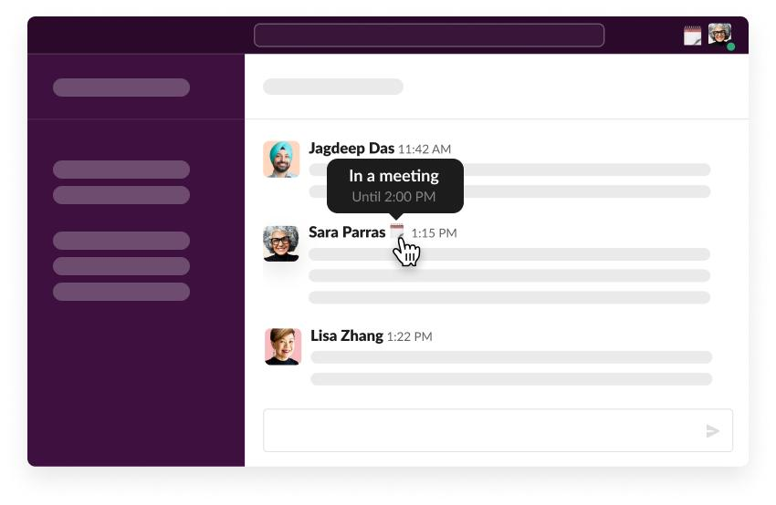
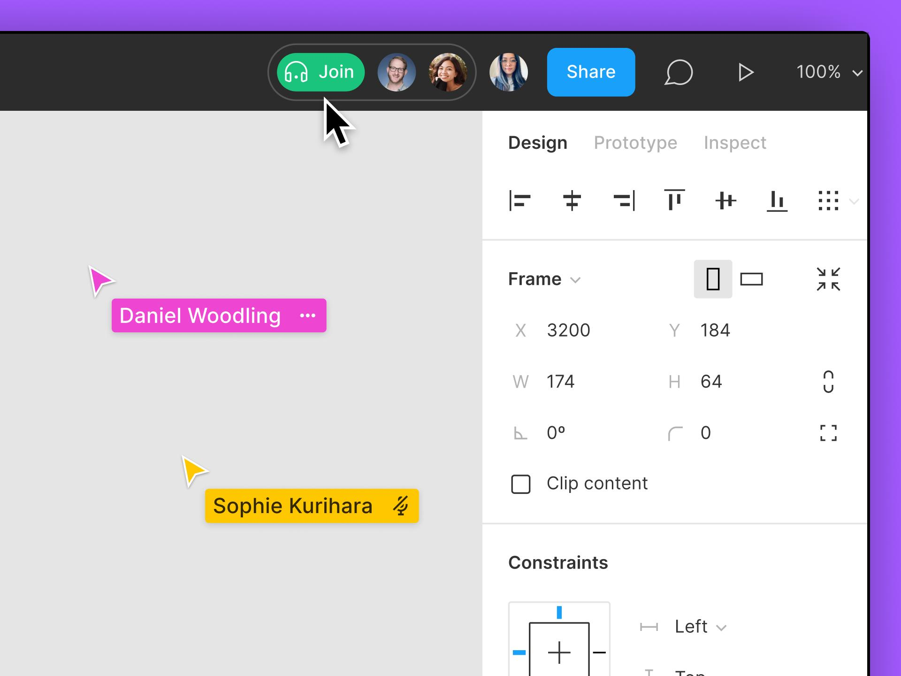

An avatar is a compact visual representation of a person, organization, or automated agent. It usually takes the form of a profile photograph, illustration, icon, or initials.

Avatars make identities easier to recognise and help users understand who is participating in a conversation, working on a document, or responsible for an action.

- User profiles and account menus
- Messaging and comment threads
- Online presence indicators
- Collaborative editing
- Assigned users and team members
- Groups of participants

## Examples

### GitHub

GitHub Discussions thread, from GitHub's official product page.

In conversational interfaces, avatars support rapid attribution. Their consistent positioning is often more valuable than their visual complexity.

- Each contributor's avatar appears alongside their message.
- Repeated avatar placement makes the conversation easier to scan.
- Avatars complement usernames rather than replacing them.
- Identity remains associated with each comment and its reactions.

### Slack

Slack showing a collaborator's meeting status, from Slack's official documentation.

Slack distinguishes availability, such as being active or away, from a user-defined status message.

A presence indicator should supplement an avatar, not be confused with the avatar itself. People need to understand both who someone is and whether they're available.

- The avatar identifies the person.
- An accompanying status indicator communicates additional information.
- Hovering reveals more detail about the person's availability.
- Identity and availability are presented as related but distinct concepts.

### Figma

Figma's collaborative editing interface, from Figma's official help center.

Avatar groups provide social awareness. In collaborative software, they help answer who is currently present and, when combined with cursor labels, where those people are working.

- Small avatars identify collaborators participating in the file.
- They appear in a shared toolbar rather than beside individual content items.
- Coloured cursors and labels connect collaborators to their activity on the canvas.
- The representation provides awareness of other people's presence without taking substantial screen space.

## States

- Image (usually a photo)
- Icon (for applications, bots, or generic accounts)
- Fallback initials

## Considerations

- **Recognition**: Use consistent avatars for the same identity throughout the product           
- **Fallback**: Provide initials or an icon when an image is unavailable                      
- **Shape**: Keep shapes consistent within a given context                                 
- **Size**: Use larger avatars for profiles and smaller ones for dense lists              
- **Identity**: Display names where ambiguity could affect comprehension                      
- **Presence**: Accompany status colours with accessible text or labels                       
- **Groups**: Provide a way to discover all participants when the group is truncated        
- **Interaction**: Make clickable avatars keyboard accessible and clearly labelled               
- **Accessibility**: Avoid repeating names unnecessarily through redundant image alternative text  
- **Privacy**: Only display identity and availability information appropriate to the context 

## Accessibility

- A decorative avatar beside an already visible username can use empty image alternative text.
- An avatar used as a profile link needs an accessible link name identifying the person.
- An initials fallback should not be the only way an identity is communicated.
- A green availability dot needs an equivalent textual meaning, such as “Available”.
- Avatar groups should also remain understandable when some members are hidden behind a count indicator.

