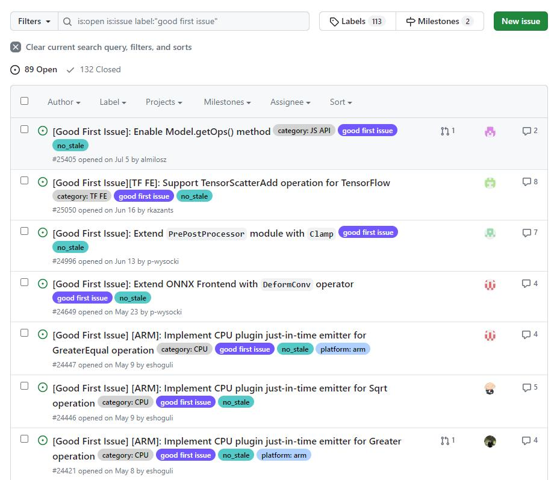
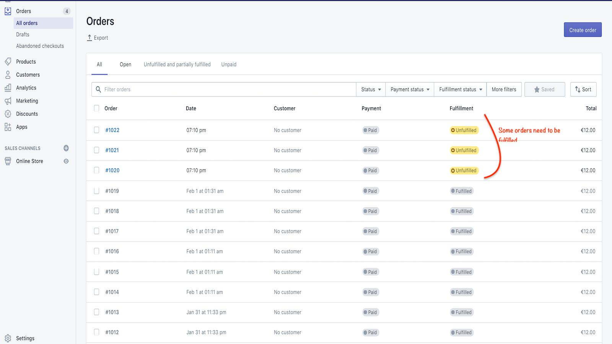
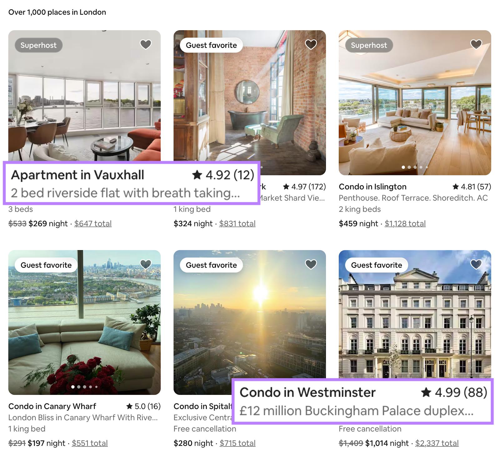

# Chip

**A badge is a small visual label used to communicate a status, category, characteristic, count, or distinction associated with another interface element.**

Badges make important metadata easy to recognise without requiring users to read longer descriptions.

They're typically compact, visually distinctive, and positioned close to the content they describe.

- Order and payment statuses
- Issue labels and categories
- Priority indicators
- Membership tiers and achievements
- New or beta feature labels
- Notification counts
- Verification and trust indicators

## Examples

### GitHub

GitHub issue list with multiple category labels, from an OpenVINO contributor guide.

GitHub allows repository maintainers to customise label names, descriptions, and colours.

Badges are especially useful when users must scan a dense list and quickly identify relevant attributes.

- Multiple badges can be associated with a single issue.
- Each badge represents a distinct classification.
- Colours help users distinguish categories while scanning.
- Labels support filtering and issue discovery.

### Shopify

Shopify Orders dashboard showing payment and fulfilment statuses, from a Shopify App Store listing.

Shopify distinguishes between payment, fulfilment, return, and other order statuses.

Status badges are most useful when their meaning is consistent and clearly associated with a specific workflow dimension.

- Payment and fulfilment are represented as separate statuses.
- Status badges appear directly within the table rows.
- Repeated styling makes exceptional states easier to identify.
- Merchants can compare the state of many orders without opening each one.

### Airbnb

Airbnb listings featuring Guest favorite and Superhost distinctions, from Semrush.

Airbnb's Guest favorite distinction is based on guest feedback and other quality criteria.

Recognition badges act as trust and decision-support signals. Their value depends on users understanding what the distinction represents.

- Badges highlight selected properties or hosts.
- They are prominently positioned on listing cards.
- Their visual treatment separates them from ordinary property metadata.
- They help users interpret signals of quality or recognition while browsing.

## Considerations

- Meaning: Use short, unambiguous labels                                              
- Colour: Assign colours consistently to related statuses or categories              
- Accessibility: Never communicate meaning through colour alone                             
- Contrast: Ensure text remains readable at small sizes                                
- Placement: Position badges close to the content they describe                         
- Density: Avoid displaying so many badges that they compete with primary information 
- Consistency: Use the same terminology and styling for equivalent states                 
- Interaction: Distinguish passive badges from clickable filters                          
- Responsiveness: Handle long labels and constrained layouts carefully                       
- Dynamic state: Keep badges synchronised with the actual application state                 

## Interaction

The visual distinction can be subtle, but the interaction model matters.

- Badge: Usually informational and non-interactive.
- Chip: Often interactive, allowing selection or removal.
- Tag: Represents a classification and may be informational or editable.
- Notification: Typically indicates a count or attention state.
