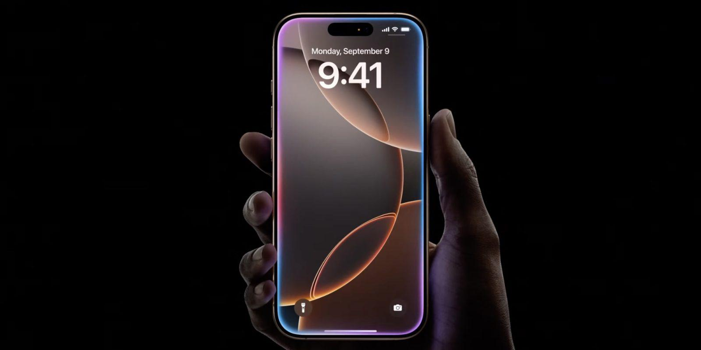
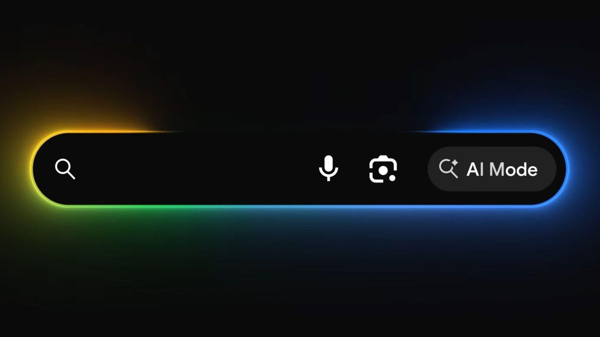

# Beam

A border Beam is a decorative effect in which a beam of light moves along the border of a UI element.

Unlike a conventional border animation that changes the entire outline, a border beam typically creates the appearance of a small light source travelling around the component's perimeter.

- Highlighting AI-powered features
- Drawing attention to featured cards
- Emphasising interactive controls
- Creating animated hover treatments
- Adding visual emphasis to promotional content

## Examples

Exact travelling-beam effects are difficult to verify from static screenshots. The following are genuine product interfaces using closely related glowing-edge treatments, rather than confirmed implementations of the exact Ant Design animation.

### Apple Intelligence

Apple's Siri interface on iPhone, showing a multicoloured glow around the display.

When Siri is activated, a colourful light effect appears around the perimeter of the screen.

The illuminated border communicates that the assistant is active while leaving the underlying screen content visible.

Apple officially describes this edge-light treatment as part of its redesigned Siri interface.

### Google Search

Google Search's AI Mode, showing a multicoloured gradient around its search input.

Google uses a colourful outline to visually distinguish its AI search experience from conventional search.

WThe gradient creates a recognisable visual identity and directs attention toward the primary input.

Google also uses animated colour around the interface when opening AI Mode on iOS. This is a related animated-border treatment, although it isn't necessarily a continuously travelling beam.

## Variations

- **Continuous**: A light segment travels repeatedly around the border                      
- **Hover**: Animation activates when the pointer enters a component                   
- **Gradient**: The moving highlight contains multiple colours                            
- **Multiple**: Two or more light segments move around the same perimeter                 
- **Pulsing**: The border glows and fades without a travelling segment                   
- **Stateful**: The effect activates during a particular interaction or application state 

## Considerations

- **Purpose**: Distinguish decorative emphasis from meaningful states such as focus, errors or processing.
- **Motion**: Avoid fast, distracting animation, particularly when repeated across many cards.
- **Reduced**: Respect `prefers-reduced-motion`. Ant Design hides its beam under the reduced-motion preference.
- **Contrast**: Ensure the border treatment remains visible against different backgrounds.
- **Performance**: Be mindful of continuously animated effects, particularly when many instances are visible.
- **Focus**: Don't replace a visible keyboard focus indicator with a purely decorative moving border.
