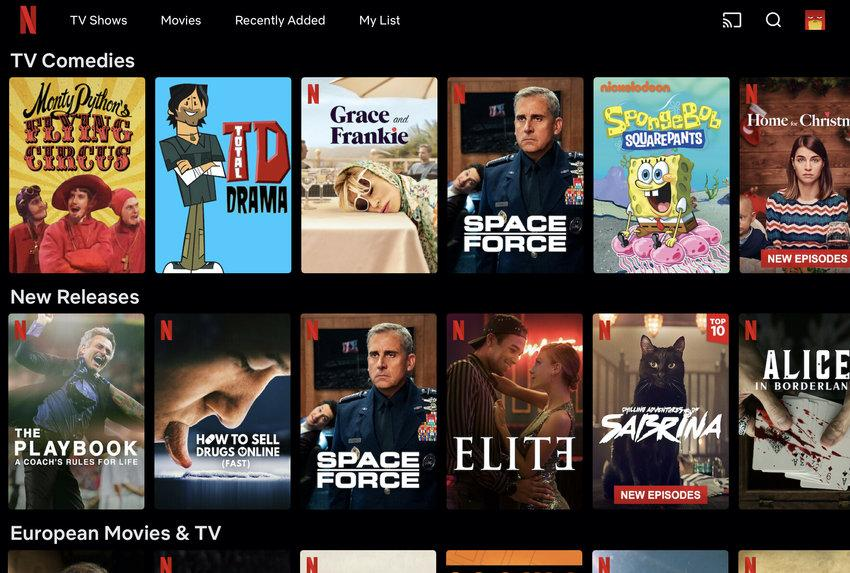

# Carousel

A Carousel displays multiple items within a limited area, allowing users to move horizontally or vertically between them.

Carousels commonly contain images, cards, products, articles or promotional content.

- Content slider
- Image slider
- Slideshow
- Swipe gallery
- Horizontal card carousel
- Content rotator

## Examples

### Netflix

Real Netflix homepage screenshot showing multiple horizontal rows of movie and television cards.

Netflix organises its content into horizontally navigable collections, grouped by themes, genres and recommendations.

Users can explore several distinct collections without each one requiring a separate page or consuming excessive vertical space. Netflix confirms that these recommendation rows are a central part of its browsing experience.&#x20;

### Amazon

Amazon product detail interface, from Amazon's official seller documentation.

Amazon uses product-image galleries to let shoppers inspect multiple views of an item.

Customers can examine a product from different angles while keeping the purchasing information nearby.

Unlike a recommendation carousel, the primary goal is to explore different images of a single product.

### Instagram

Real Instagram carousel post screenshots showing the image counter and pagination dots.

Instagram allows multiple photos or videos to be grouped into a single post.

Users swipe between slides, with indicators communicating their current position in the collection.

Multiple pieces of related content can be presented without overwhelming the feed or requiring separate posts.

## Variations

- **Single**: One slide displayed at a time                               
- **Multiple**: Multiple cards visible simultaneously                       
- **Image**: Gallery of photos, usually with navigation arrows or dots   
- **Card**: Horizontally scrollable cards containing structured content 
- **Infinite**: Wraps from the final item back to the first                 
- **Autoplay**: Automatically advances between slides                       
- **Thumbnail**: Uses selectable thumbnails as navigation                    
- **Peek**: Reveals part of the next item to suggest more content       
- **Fade**: Crossfades between slides instead of sliding                
- **Vertical**: Advances content vertically                                

## Considerations

- **Discoverability**: Make it obvious that additional items exist. A partially visible next card often helps.
- **Controls**: Provide arrows, swipe gestures or other suitable navigation mechanisms.
- **Indicators**: Use dots, counters or thumbnails where understanding the current position matters.
- **Autoplay**: Avoid automatically advancing interactive or information-heavy content. Provide pause controls if autoplay is enabled.
- **Accessibility**: Support keyboard navigation, appropriately labelled controls and understandable slide changes.
- **Reduced**: Respect users' motion preferences.
- **Performance**: Avoid loading every high-resolution image before the carousel becomes usable.
