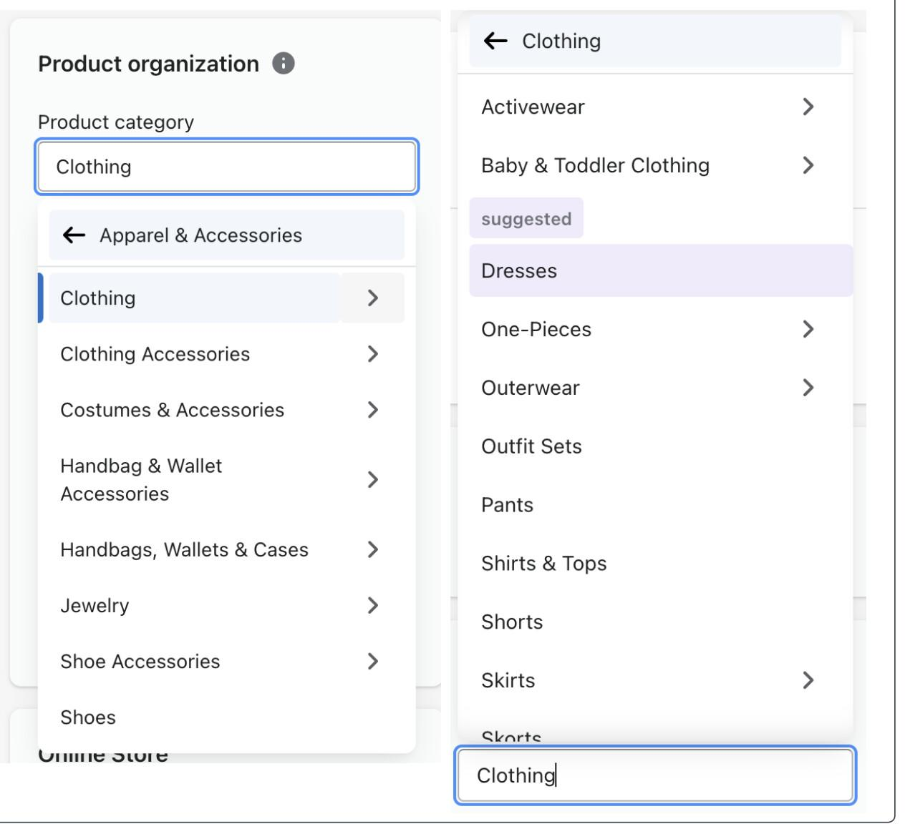
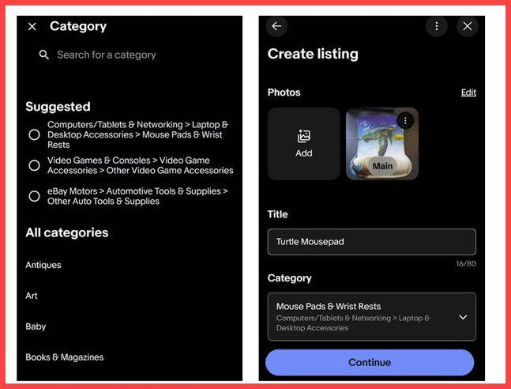
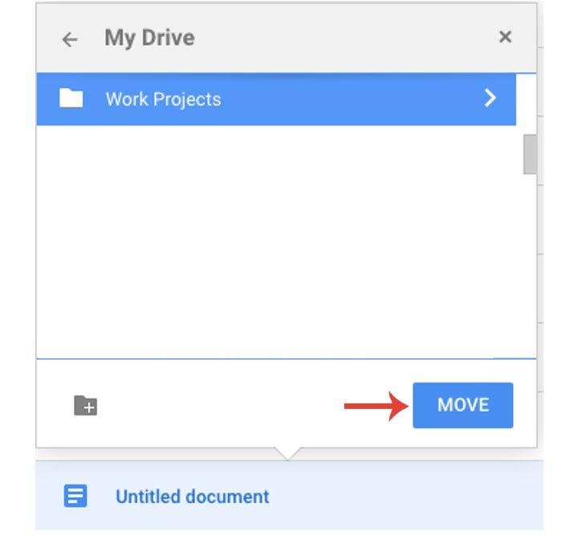

# Cascader

A Cascader lets users select a value from a hierarchy of related options.

Selecting an item at one level reveals the available choices at the next level, typically in an adjacent column or a replacement panel.

- Cascading selector
- Hierarchical picker
- Multi-level dropdown
- Category picker
- Drill-down selector

## Examples

### Shopify

Real Shopify Admin screenshot showing parent categories alongside their subcategories.

Shopify allows merchants to select a product category by progressively navigating through its taxonomy.

The selected parent reveals its children in the adjacent panel.

Users can browse a large classification system without seeing every possible category simultaneously.

Shopify supports both searching for categories and navigating through each level.

### eBay

Real eBay listing interface showing category suggestions and complete category paths.

eBay allows sellers to choose where their products belong within a hierarchical classification.

For example, a mousepad might be categorised under:

`Computers/Tablets & Networking → Laptop & Desktop Accessories → Mouse Pads & Wrist Rests`

Showing the complete path helps users distinguish similarly named categories and confirm that they're choosing the correct destination.

### Google Drive

Real Google Drive screenshot showing the destination folder selection dialog.

Google Drive uses a related hierarchical selection pattern when moving files.

Rather than displaying every hierarchy level in adjacent columns, users navigate into folders to select a destination.

Why it works: The drill-down approach handles potentially deep folder structures within a compact dialog.

This is a close relative of a Cascader, rather than the same multi-column
presentation.

## Variations

- **Multi-column**: Each hierarchy level appears in a new column            
- **Drill-down**: Each selection replaces the current list                
- **Searchable**: Users search across hierarchical paths                  
- **Multi-select**: Multiple values or branches can be selected             
- **Lazy-loaded**: Child options load only when a parent is opened         
- **Parent-selectable**: Users can select an intermediate category               
- **Hover**: Moving the pointer over a parent reveals its children   
- **Mobile**: Hierarchy levels appear as successive screens or sheets 

## Considerations

- **Hierarchy**: Differentiate parent categories from selectable end values.
- **Selected**: Show the full hierarchy after selection where context matters.
- **Search**: Provide search when the hierarchy contains many levels or unfamiliar terminology.
- **Depth**: Deep hierarchies can become difficult to navigate, particularly on mobile.
- **Keyboard**: Support movement between levels, selection and returning to the parent.
- **Loading**: Indicate when child options are being fetched asynchronously.
- **Rules**: Make it clear whether only leaf nodes or also parent categories can be selected.
