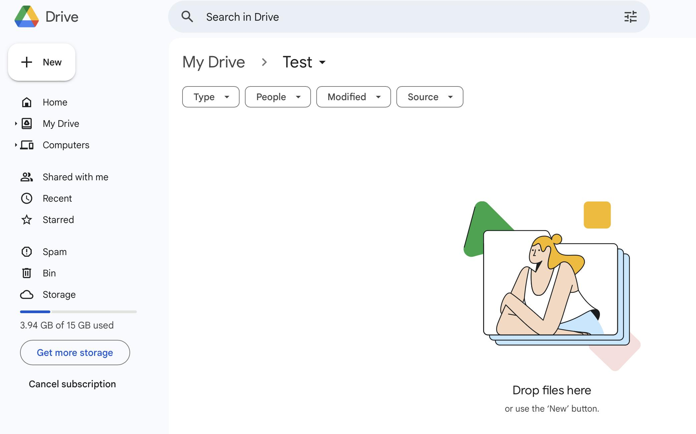
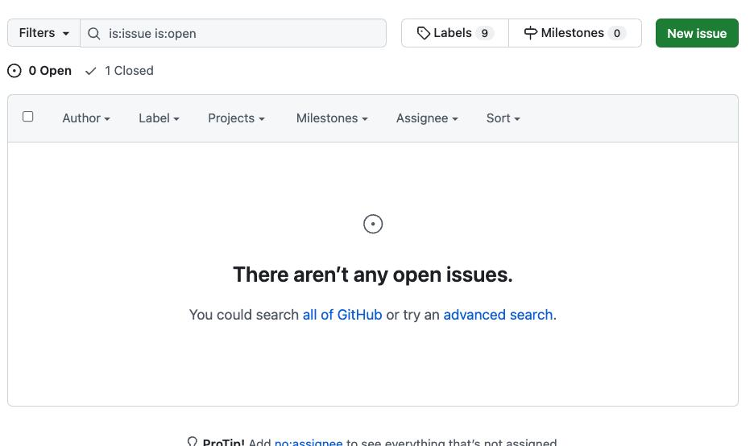
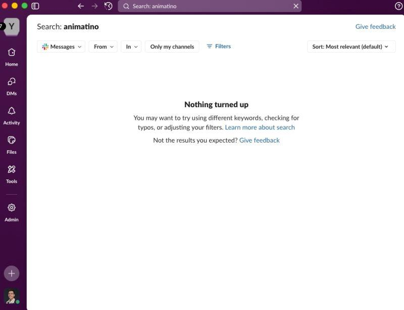
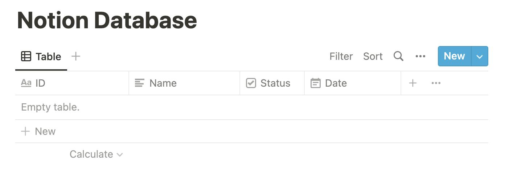

# Empty

**An empty state is an interface displayed when a section has no content to show.**

Its purpose is to explain why nothing appears and, where appropriate, help the user take the next step.

- An illustration or icon
- A short, descriptive heading
- Supporting text
- A primary action, such as Create project
- Occasionally, a secondary action or help link

## Examples

### Google Drive

The folder has no files. Google Drive displays:

- A centred illustration
- Instructions to drop files into the area
- A reference to the existing New button

The illustration helps users recognize the empty state, while the instructional text identifies two ways to populate it.

### GitHub

The issue list contains no matching open issues.

- Clear message: “There aren’t any open issues”
- Search suggestions for exploring other issues
- A New issue button remains visible

The message describes the current view, not necessarily the repository's entire issue history. This distinction matters when filters are active.

### Slack

A search returns no matching messages.

- The empty state acknowledges that no results were found.
- It suggests checking spelling and adjusting filters.
- Search controls remain accessible.

Unlike a first-use empty state, this one should focus on helping users revise their query. It generally doesn't need a creation button.

### Notion

The table retains its column headings but contains no records.

- The table structure remains visible.
- There is no prominent centred illustration.
- The normal database controls remain available.

An elaborate placeholder isn't always necessary. In a familiar data-editing
interface, preserving the empty structure can communicate what belongs there.

## Variations

- **Start**: No projects yet 
- **Folder**: This folder is empty       
- **Search**: No matches found            
- **Filtered**: No items match these filters 
- **Completed**: You're all caught up        
- **Permission**: You can't access this content

## Considerations

1. **Failure**. An empty collection, loading operation, network error, and permission failure should not share the same generic message.
2. **Specific**. “No invoices found” is more useful than “No data.”
3. **Suggest**. Offer a creation action for first-use states and filter adjustment for no-result states.
4. **Illustrations** . They work well for onboarding but can be distracting in dense enterprise dashboards.
5. **Context**. Keep relevant filters, headings, and controls visible.
6. **Avoid**. “No results match your search” is more helpful than “Invalid search.”
7. **Accessibility**. Important messages should be text, with decorative illustrations excluded from the accessibility tree.
