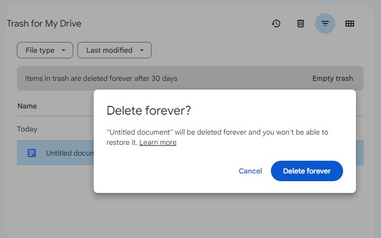
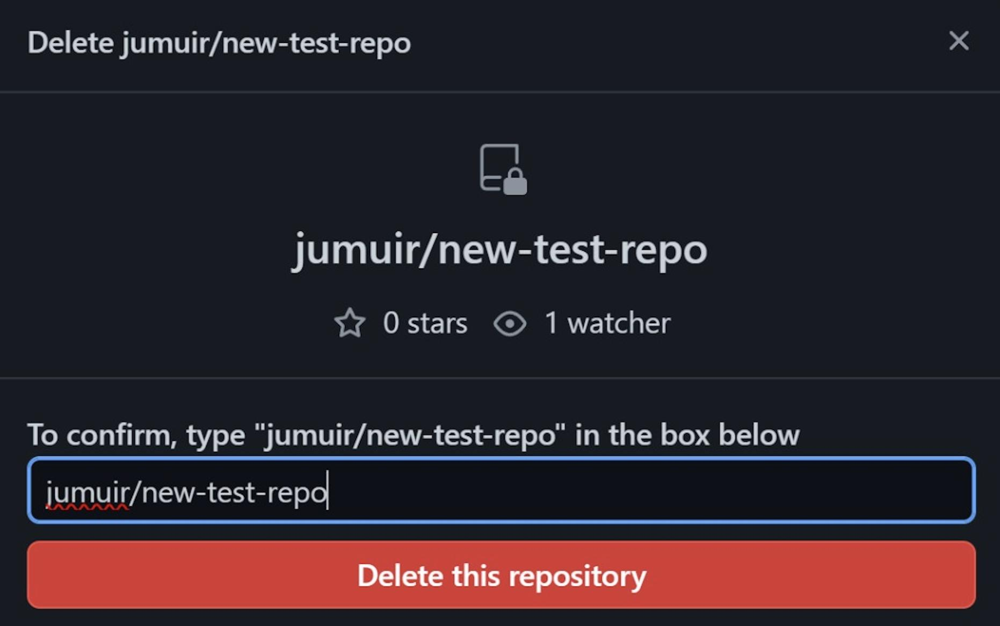
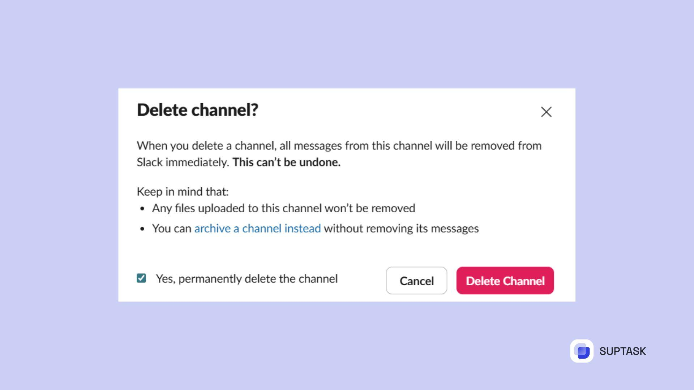

# Modal Confirm

An alert dialog is a modal interface that interrupts the user's current task to communicate something important and require an explicit response.

It is particularly useful for consequential actions such as deleting information, discarding unsaved changes, or changing important account settings.

Unlike a regular alert, an alert dialog temporarily prevents interaction with
the underlying interface.

- Appears above the current interface, usually with a backdrop.
- Contains a clear title and explanation of the consequences.
- Requires an explicit decision, typically Confirm or Cancel.
- Keeps keyboard focus within the dialog while open.
- Sometimes introduces additional confirmation steps for high-risk actions.

An alert dialog introduces a substantial interruption. Avoid it when:

- An action is harmless and easily reversible.
- Users can recover through an obvious Undo action.
- The information can be presented as an inline alert.
- You're confirming every routine action without a clear benefit.

## Considerations

- **Necessity**: Reserve interruptions for actions with meaningful consequences
- **Title**: Name the specific action, rather than asking a vague question
- **Description**: State exactly what happens if the user continues
- **Labels**: Prefer “Delete repository” over generic “Yes” or “Continue”
- **Focus**: Consider placing initial focus on the least destructive option
- **Escape**: Offer a clearly identifiable Cancel action                            
- **Keyboard**: Keep focus within the modal and restore it appropriately on dismissal 
- **Destructive**: Distinguish destructive actions without relying solely on colour      
- **Friction**: Use checkboxes or typed confirmation only when justified              
- **Recoverability**: Prefer Undo or recovery mechanisms where practical

## Accessibility

- The dialog should expose `role="alertdialog"` with an accessible title and description.
- Keyboard focus moves into the dialog when it opens.
- The underlying interface should not be interactive while the dialog is modal.
- Focus should remain inside until the dialog closes.
- On dismissal, focus should usually return to the invoking control, unless the workflow changes context.

For destructive actions, initial focus on Cancel can reduce accidental confirmation.

## Examples

### Google Drive

Google Drive's permanent file deletion confirmation.

When the action and its consequences are straightforward, a short confirmation can provide sufficient protection.

- A concise question identifies the action being confirmed.
- The description warns that the file cannot be restored.
- Two buttons provide a clear choice: Cancel or Delete forever.
- The background remains visible, providing context without competing for attention.

### Github

Requiring users to enter a specific name helps verify that they understand which resource is affected.

This is an example of intentional friction. It can be appropriate for high-risk actions, but would be excessive for routine tasks.

GitHub also documents recovery options for some deleted repositories, so the consequences are not universally irreversible

- The dialog identifies the exact repository being deleted.
- Users must type the repository path before proceeding.
- The destructive action is visually distinguished through red styling.
- The confirmation introduces deliberate friction for an unusually consequential operation.

### Slack

Slack's channel deletion confirmation.

Confirmation dialogs can do more than ask users to approve an action. They can help users make a better decision by explaining alternatives.

Slack documents that archiving preserves a channel's history, while deletion permanently removes the channel and its messages.

- The dialog explains the consequences of deleting a channel.
- A checkbox requires explicit acknowledgement before confirmation.
- It distinguishes channel messages from uploaded files.
- It recommends archiving as a less destructive alternative.
