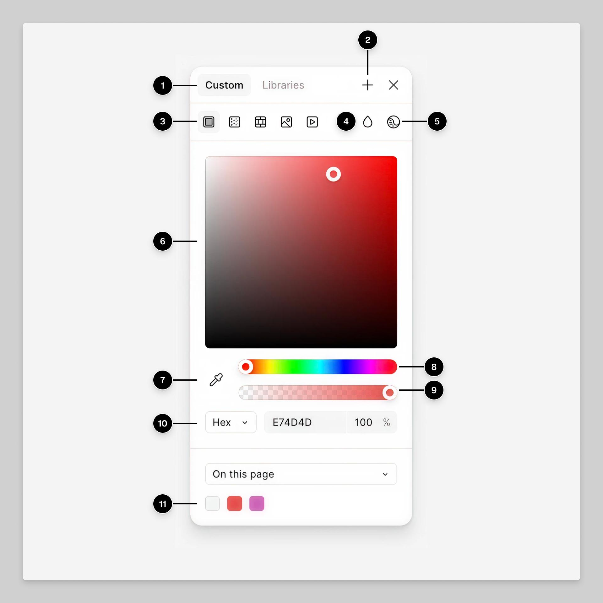
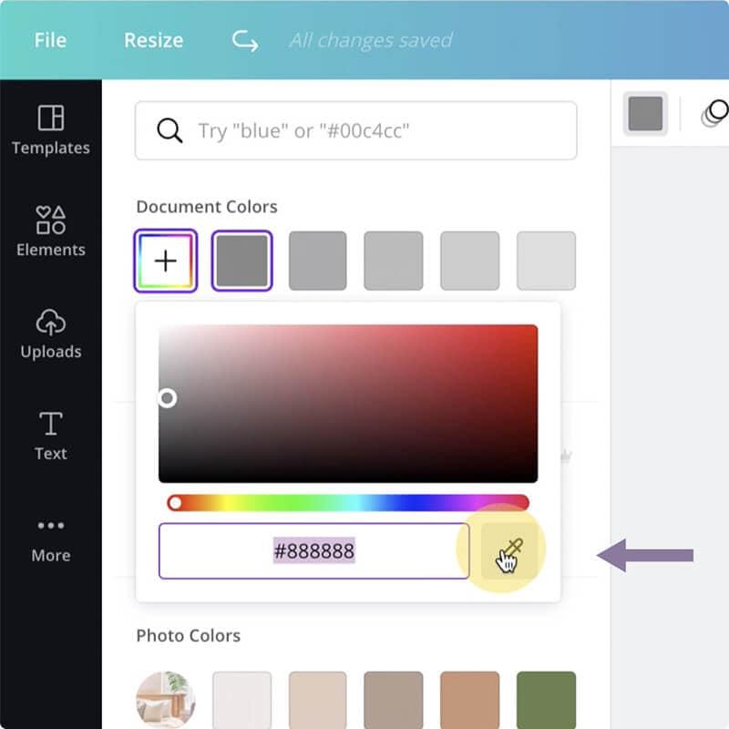
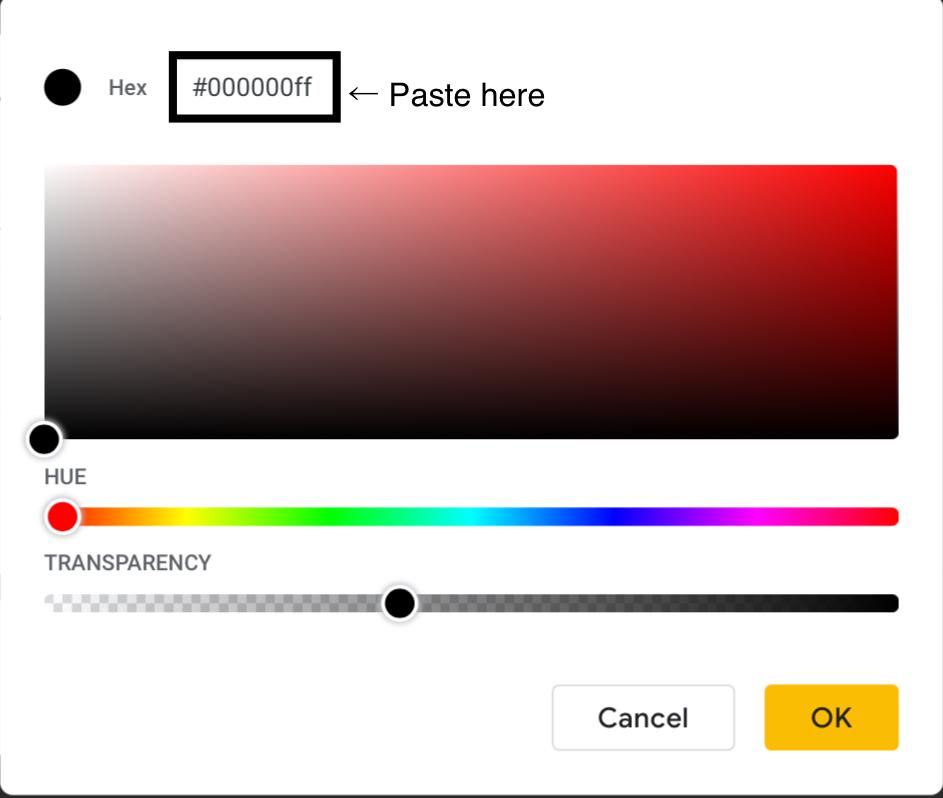

# Picker

A color Picker allows users to select and adjust colours through a visual interface rather than entering colour values manually.

- A two-dimensional colour spectrum
- Hue slider
- Opacity or alpha slider
- HEX, RGB or HSL input fields
- Eyedropper for sampling colours
- Preset colour swatches
- Gradient editing controls

## Examples

### Figma

Official Figma screenshot showing its colour picker panel.

Figma provides a sophisticated colour picker for editing fills and strokes.

Users can adjust colour visually, enter precise values, modify opacity and select colours from shared libraries.

Why it works: It accommodates both exploratory colour selection and precise design-system work.

Figma also supports multiple colour models and includes tools for assessing colour contrast.

### Canva

Real Canva interface screenshot showing its custom colour picker, palette swatches and HEX input.

Canva combines visual colour selection with reusable colours from documents, images and brand palettes.

Why it works: Users can either explore colours freely or quickly reuse colours already established in their designs.

Canva's Brand Kit also makes approved colour palettes available across designs.

### Google Slides

Real Google Slides custom colour picker, captured in an earlier interface version.

Google Slides offers a dedicated dialog for selecting custom colours using the spectrum or numeric colour values.

Why it works: It provides more precise controls when predefined palette colours are insufficient.

Google's editing tools also support HEX and RGB entry and an eyedropper for sampling screen colours.

## Variations

- **Spectrum**: Select a colour from a two-dimensional colour field
- **Hue**: Choose a hue using a slider or colour wheel
- **Swatch**: Select from predefined colour samples
- **Eyedropper**: Sample a colour from an image or the screen
- **Numeric**: Enter HEX, RGB, HSL or other colour values
- **Alpha**: Adjust colour opacity or transparency
- **Gradient**: Create colours that transition between multiple stops
- **Brand**: Choose from approved organisation or project colours

## Considerations

- **Precision**: Combine visual controls with editable numeric values.
- **Feedback**: Show a preview of the currently selected colour.
- **Transparency**: Use a checkerboard or another understandable representation of alpha.
- **Accessibility**: Avoid relying on hue differences alone and provide keyboard-operable alternatives to dragging.
- **Contrast**: Consider displaying contrast information when selecting foreground and background colours.
- **Formats**: Clearly label HEX, RGB, HSL and other supported models.
- **Presets**: Surface recently used or brand-approved colours where relevant.
