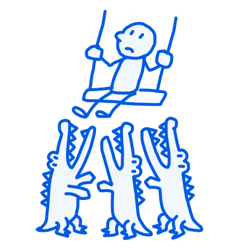
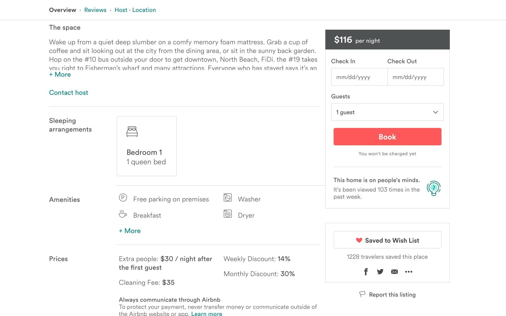
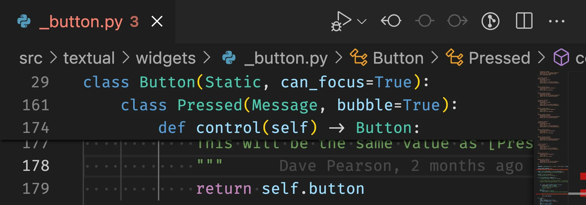

# Sticky

**A Sticky element keeps an interface element visible as the user scrolls. The element normally participates in the page layout, then becomes anchored to the viewport once it reaches a specified threshold.**

- Sticky navigation bars
- Persistent booking or checkout panels
- Sticky section headings
- Floating action toolbars
- Sticky contextual information

## Example

### Airbnb

Real Airbnb listing screenshot, captured from an earlier version of the product.

On desktop, Airbnb uses a booking panel alongside the listing details. The panel remains accessible while users explore the property's description, amenities and other information.

Users can refer to pricing and booking controls without repeatedly scrolling to
the top.

### Visual Studio Code

Real VS Code screenshot showing nested code context pinned at the top of the editor.

VS Code's Sticky Scroll feature keeps the enclosing class, function or other code scopes visible while scrolling through a file.

Developers retain structural context in long files, and the pinned headings provide shortcuts back to the corresponding declarations.

### GitHub

GitHub uses sticky headers in pull-request diffs to keep the current file's identity visible when reviewing long changes.

Why it works: Reviewers don't lose track of which file they're inspecting.

## Considerations

- Scroll threshold: Decide when the element should begin sticking.
- Boundaries: Prevent sticky elements from escaping their relevant content region.
- Space: Avoid covering important content, particularly on mobile.
- Priority: Reserve persistent visibility for genuinely useful controls or context.
- Accessibility: Ensure pinned controls do not obscure keyboard focus or anchor destinations.
