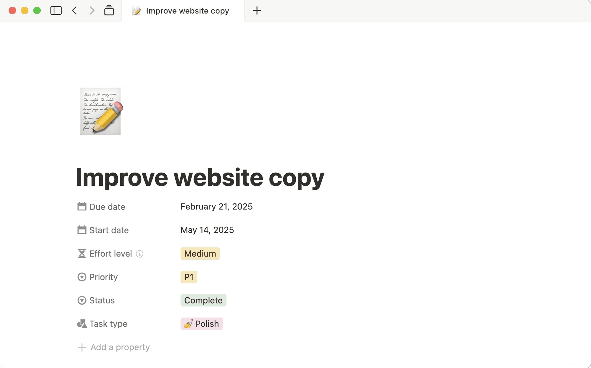
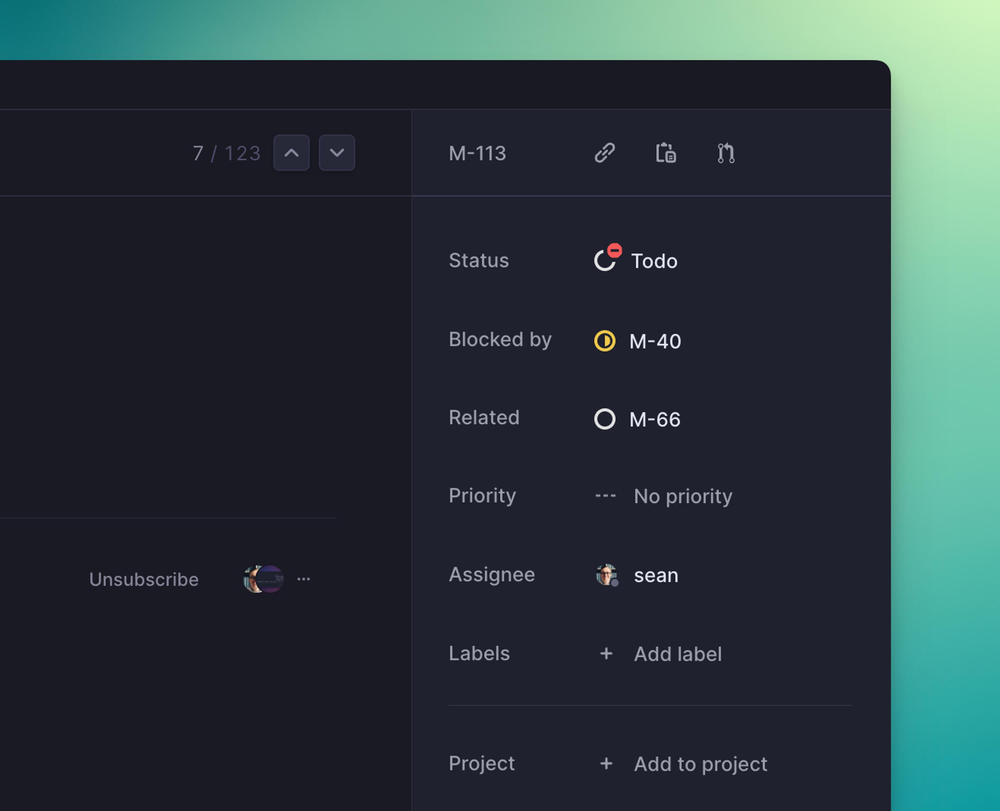
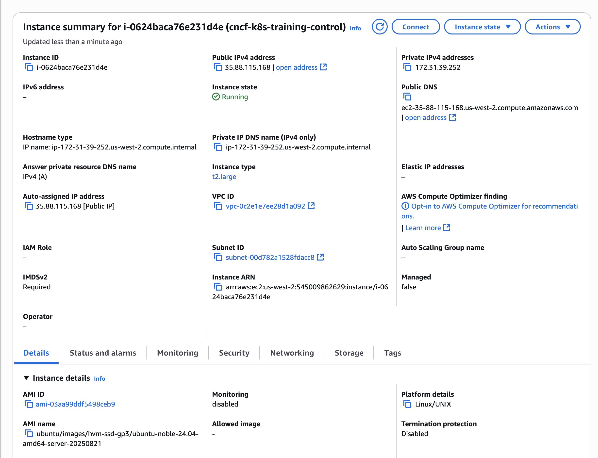

# Values

Descriptions presents information about a single object as a collection of labels and values.

It's particularly useful on detail pages where users need to scan attributes without editing them—for example, an order's payment information, a server's configuration, or a project's metadata.

Also known as: 

- Property list
- Detail summary
- Metadata panel
- Definition list

## Examples

### Notion

A task's attributes appear as vertically stacked label–value pairs.

- Labels: Due date, Effort, Priority, Status, Type.
- Values: Dates, text, coloured badges, and selections.
- Layout: Compact, single-column property list.

Notion extends the traditional read-only pattern by letting users edit many properties directly.

### Linear

Linear places the issue's metadata in a persistent side panel.

- Labels: Status, Priority, Assignee, Project, Labels.
- Values: Text, avatars, icons, and badges.
- Layout: Narrow property sidebar beside the primary content.

This arrangement works especially well when the attributes provide context for a larger document or task.

### Amazon EC2

The instance summary uses a dense, multi-column arrangement.

- Labels: Instance ID, type, IP addresses, AMI, state, networking information.
- Values: Identifiers, addresses, status indicators, and linked resources.
- Layout: Responsive grid with multiple label–value pairs per row.

### Stripe

The payment view combines summary information with detailed transaction attributes.

- Labels: Payment method, fee, gross amount, net amount, description.
- Values: Currency, masked card details, timestamps, and text.
- Layout: Grouped details beneath a prominent payment summary.

This demonstrates how descriptions can support financial records and audit-oriented interfaces.

## Considerations

- **Label** alignment: Consistent positions make attributes easier to scan.
- **Long**: Allow wrapping for addresses, URLs, and descriptions.
- **Responsive**: Collapse multi-column layouts on narrow screens.
- **Empty**: Distinguish missing data from zero, false, or an intentionally blank value.
- **Copyable**: Make technical identifiers and addresses easy to copy.
- **Semantics**: A native HTML `<dl>` with `<dt>` and `<dd>` is often appropriate for read-only label–value pairs.
- **Editing**: Clearly distinguish selectable values from interactive fields.

