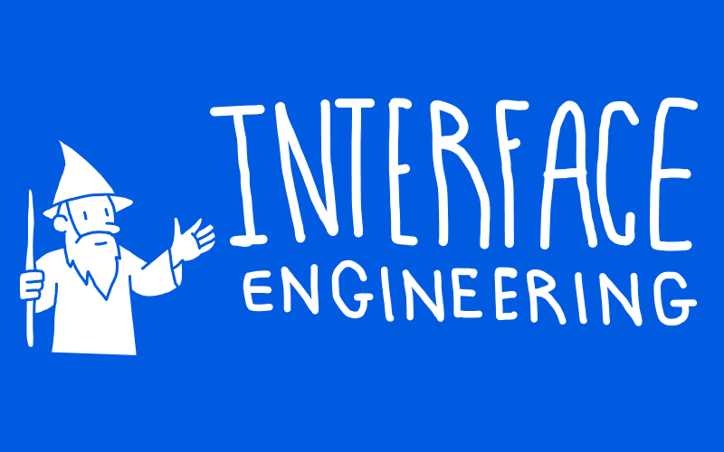

# Interface Engineering

**A personal (mostly reasonable) approach to user interfaces**

## Overview

### 👋 Introduction

**This document is maintained by myself, [Schalk
Venter](https://schalkventer.me/).**

I am a product designer and software engineer based in Cape Town, South Africa.
I've been designing, maintaining and leading teams that work on extremely
interactive and highly stateful user-facing interfaces over the past decade. 

### 🎯 Purpose

**The purpose of this document is to be a living, evolving artefact, in which I
codify and share some personal approaches and heuristics I've developed over my
career.** 

It effectively outlines how I approach designing, extending and/or building user
interfaces that have significant state and interaction complexity.

I generally find it tech stack and tooling agnostic.

### 🧠 Bias

**It is important to note that this approach might not work that well for
interfaces that have little complexity such as landing pages, marketing sites,
or simple content pages.**

I've found that the expectation of high levels of interactivity has a quality of
its own, influencing the entire way in which I approach the projects. Given
this, I don't know how well this would scale for simpler interfaces.

## Artificial Intelligence

### 🔮 Future

`TODO`

### 🤖 Disclaimer

**English is not my native language.**

So I do rely on AI to help me fix grammar and weird sentence structures.
However, this document (while I hope is helpful to others) is primarily intended
for my own use and reflection. 

This means that I try and keep as high level of signal-to-noise/intent as
possible, which means that generative AI actually gets in the way, since it
loves to add extra verbage and fluff.

## Structure

I'm not particularly set on the structure that this document should adhere to,
however it does seems that the following categories are emerging organically as
I add to the document.

### 🧠 Process

**How I go about making sense of and documenting the underlying concept that the
interface actually represent.**

When making value judgments about an interface, I generally find myself
primarily concerned with whether the interface itself accurate represents the
actual relationship and structure underneath it.

Granted, even the way of modelling the underlying relationships and structures
can be flawed, so if the underlying model is incorrect, then the very measure
you use to determine whether an interface is good/bad is calibrated incorrectly.

### 🎨  Patterns

Below is a tentative mapping of how I tend to reason about common patterns in
interface design.

::: warning Work in Progress

This still super raw, and I'm busy refining it. I just dumped some common
patterns I could think of in a broad hierarchy.

:::

### 📚  Resources

::: warning Work in Progress

Yup. This too!

:::