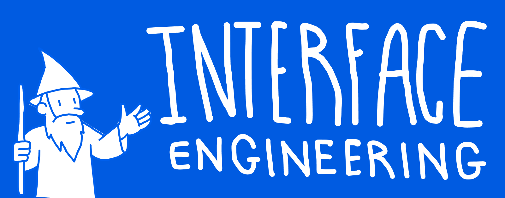
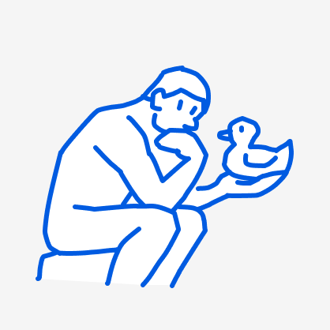
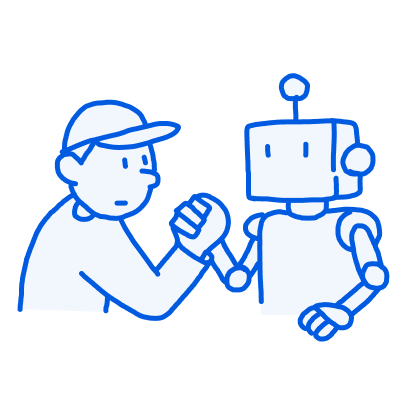
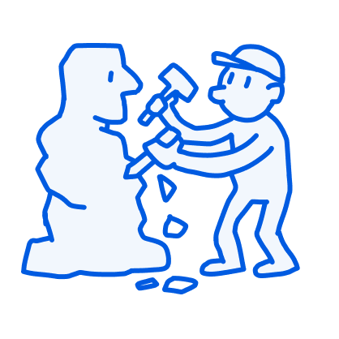
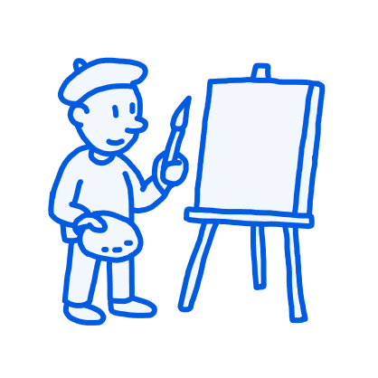

# Interface Engineering

**A mostly reasonable approach to designing software interfaces**

## Overview

::: info Slop Free Zone

As a non-native English speaker, I do use AI here and there to fix my grammar
and weird phrasing. However, actual content itself should have high
signal-to-noise. Please let me know if you notice anything that could be improved.

:::

### Introduction

This document is maintained by myself, [Schalk
Venter](https://schalkventer.me/). A software engineer and interaction designer
based in Cape Town, South Africa. I've been designing, maintaining and leading
teams that work on extremely interactive and highly stateful user-facing
interfaces over the past decade. 

This document aims to be a living, evolving document, in which I attempt to
codify and share some personal approaches and heuristics I've developed over
this period. The following effectively outlines how I approach designing,
extending and/or building user-facing project that has significant state and
interaction complexity, regardless of tooling and tech-stack that might be used.

To that end it is important to note that this approach might not work that well
in applications that have little interface complexity such as landing pages,
marketing sites, or simple content pages. In the case of the latter I would
consider a completely different set of tools and approaches.

### Reality of AI

`// @TODO`

## Content

At the moment this document is primarily organised around three sections:

- Model
- Presentation
- Resources

### Model

`// @TODO: How I go about making sense of what the interface is actually representing`

### Presentation

- `// @TODO: Visual patterns and patterns that can be used to represent the domain`

### Resources

`// @TODO: Resources and books that have influenced my thinking in this area`

