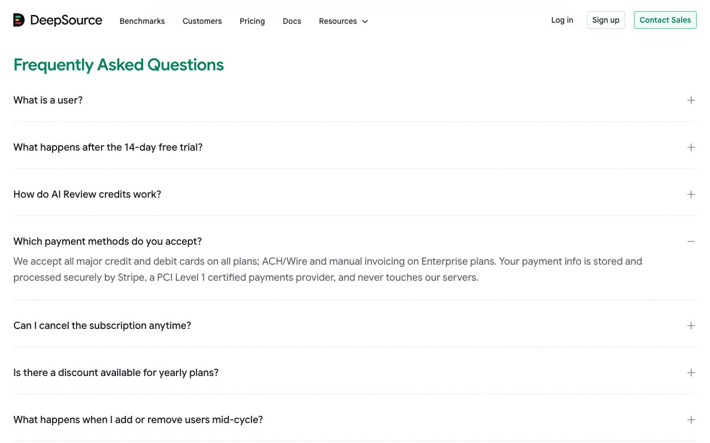
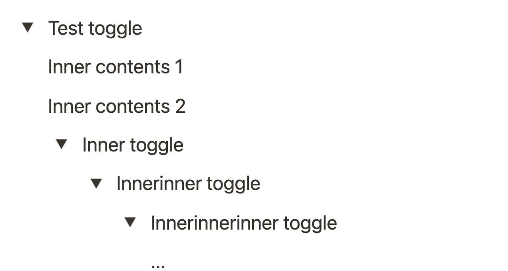
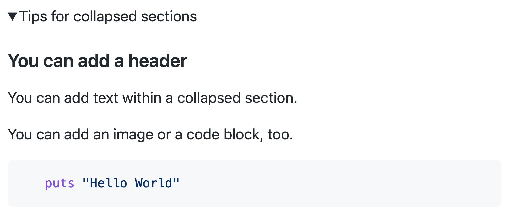

# Accordion

An accordion is a collection of expandable sections. Each section has a heading or trigger that reveals or hides associated content.

Accordions help people explore information without displaying everything simultaneously. They're commonly used for FAQs, product details, settings, and documentation.

- Multiple labelled sections arranged vertically.
- A visual indicator, commonly a chevron or plus/minus icon.
- Sections expand and collapse on activation.
- Implementations may allow one or several sections to remain open.
- Expanded state should be communicated to assistive technologies.

## Examples

### DeepSource

FAQ Accordions

- Questions are arranged as a scannable vertical list.
- The expanded answer appears directly below its question.
- The open section is visually distinguished from closed sections.
- The pattern helps prospective customers investigate pricing and billing concerns.

### Notion

Nested toggle lists within the Notion editor.

- Toggle controls can contain other toggle controls.
- Indentation communicates the parent-child relationship.
- Multiple sections can remain expanded simultaneously.
- Users control information density while writing and reading.

Notion calls these toggle lists. They're related to accordions but are independent disclosures, rather than necessarily a single accordion widget.

### GitHub

GitHub's rendered Markdown disclosure control.

- A small disclosure triangle indicates expandable content.
- Hidden content can contain headings, text, images, and code.
- Individual disclosures remain independent.
- GitHub supports this using native HTML `details` and `summary` elements.&#x20;

## Considerations

- **Default**: Open essential information; collapse supplementary information                     
- **Panels**: Choose single-open or multiple-open based on whether users need to compare content 
- **Visual**: Use consistent, recognisable expand/collapse indicators                            
- **Target**: Make the entire heading an interactive target                                           
- **Content**: Avoid hiding critical instructions users must notice                               

## Accessibility

One important distinction: a collection of disclosures can look like an accordion without implementing the full accordion interaction pattern. The [WAI-ARIA guidance](https://www.w3.org/WAI/ARIA/apg/patterns/accordion/?utm_source=chatgpt.com) describes the expected semantics and keyboard interactions for an accordion specifically.
