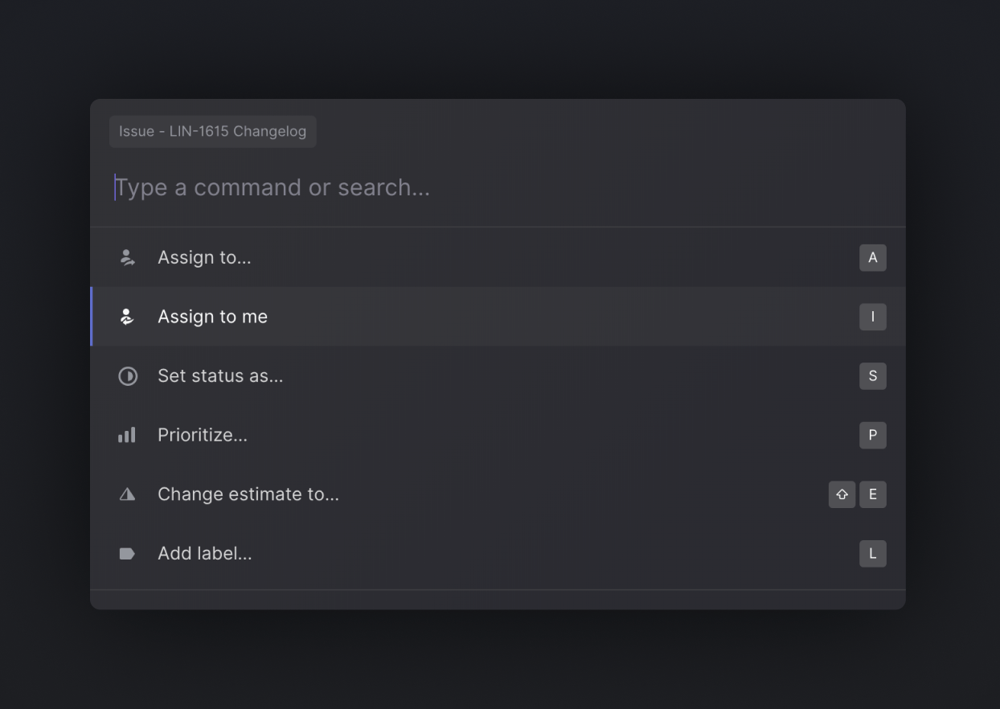
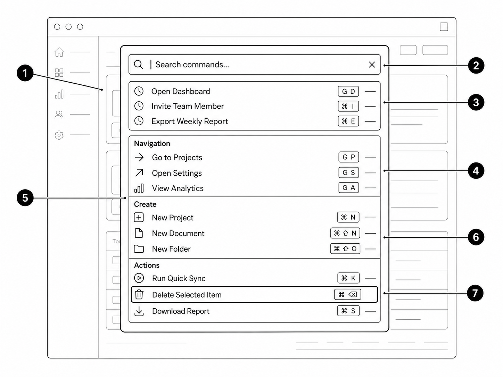

# Command Palette

A **command palette** is a searchable overlay that lets users navigate or perform actions without hunting through menus.

Image | Description
|---|---|
 | **Linear:**: Search issues, create new issues and change properties such as status, priority or assignee. Linear prioritises commands according to the user’s current screen or selected item. 
 | **Notion:** Quickly open recent pages, search the workspace, create pages and access related actions.
 | **Raycast:** Search across installed applications and execute commands from a single keyboard-driven interface.
 | **Slack:** Its Quick Switcher uses the same general pattern to jump directly to channels and conversations.

### Anatomy

1. A modal overlay above the current interface.
2. A focused search input.
3. Suggested or recently used commands.
4. Results grouped by type, such as **Navigation**, **Create** and **Actions**.
5. Icons that help users scan the list.
6. A highlighted result that can be selected with Enter.

### Good Uses

Use it in applications with many destinations or actions, especially:

* Project-management tools
* Developer tools
* Administration dashboards
* Document editors
* Large enterprise applications

It is particularly useful for experienced users who repeat actions frequently.

### Notes

Keep normal menus and buttons available—the command palette should accelerate the interface rather than become the only way to use it. Results should support fuzzy matching, clearly distinguish navigation from actions and adapt to the current context. Linear, for example, places contextually relevant commands earlier in the list.

### Reading

- https://linear.app/docs/editor
- https://slack.engineering/a-faster-smarter-quick-switcher