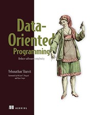
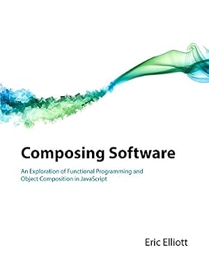
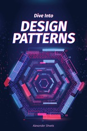
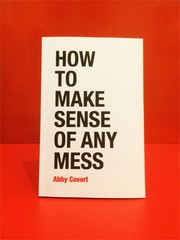
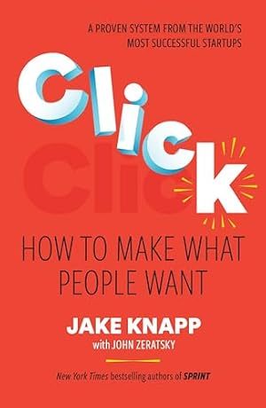
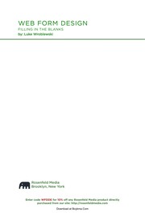
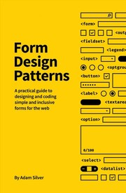
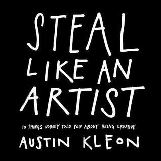
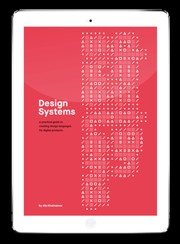

# Resources

Most of by reading notes are at: [https://github.com/schalkventer/reading-notes](https://github.com/schalkventer/reading-notes)

## Software

-  A Philosophy of Software Design (2018)
-  Data-Oriented Programming (2022)
-  Composing Software (2018)
-  Dive into Design Patterns (2018)

## Product

-  How to Make Sense of Any Mess (2014)
-  Just Enough Research (2013)
-  Click (2020)
-  The Goal (1984)
  
## Usability

-  Web Form Design (2008)
-  Form Design Patterns (2018)

## Patterns

-  Steal Like an Artist (2012)
-  Design Systems (2017)