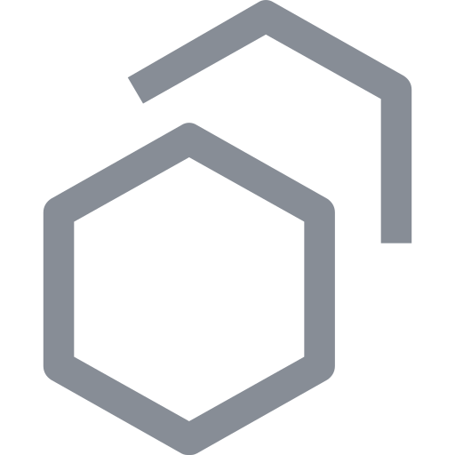
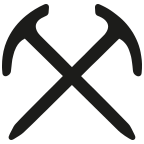
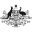
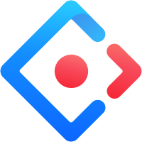
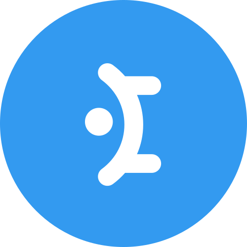
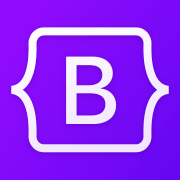
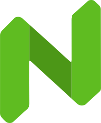
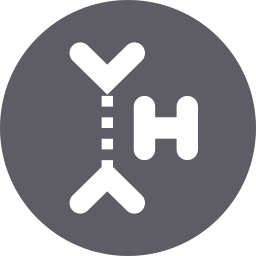

# Systems

**A list of various popular design systems in the wild.**

## 💼 Corporate Brands

### {.favicon} [Material Design 3](https://m3.material.io) (Google)

Probably one of my first introductions to a large-scale design system way back
with Material Design 1. Not really a fan of the overall new direction of MD3.

### Other

- {.favicon} [Human Interface Guidelines](https://developer.apple.com/design) (Apple)
- {.favicon} [Fluent 2](https://fluent2.microsoft.design) (Microsoft)
- {.favicon} [Carbon Design System](https://carbondesignsystem.com) (IBM)
- {.favicon} [Atlassian Design System](https://atlassian.design) (Atlassian)
- {.favicon} [Polaris](https://shopify.dev) (Shopify)
- {.favicon} [Spectrum](https://spectrum.adobe.com) (Adobe)
- {.favicon} [Lightning Design System](https://lightningdesignsystem.com) (Salesforce)
- {.favicon} [Primer](https://primer.style) (GitHub)
- {.favicon} [SAP Fiori](https://sap.com/design-system) (SAP)
- {.favicon} [Cloudscape](https://cloudscape.design) (Amazon Web Services)
- {.favicon} [PatternFly](https://patternfly.org) (Red Hat)
- {.favicon} [Base](https://base.uber.com) (Uber)
- {.favicon} [Elastic UI (EUI)](https://eui.elastic.co) (Elastic)
- {.favicon} [Paste](https://www.twilio.com/docs/paste) (Twilio)
- {.favicon} [Pajamas](https://design.gitlab.com) (GitLab)
- {.favicon} [Garden](https://garden.zendesk.com) (Zendesk)
- {.favicon} [Gestalt](https://gestalt.pinterest.systems) (Pinterest)
- {.favicon} [Cedar](https://cedar.rei.com) (REI Co-op)
- {.favicon} [Backpack](https://www.skyscanner.design) (Skyscanner)
- {.favicon} [Visa Product Design System](https://design.visa.com) (Visa)
- {.favicon} [Dialtone](https://dialtone.dialpad.com) (Dialpad)
- {.favicon} [Coral](https://design.talend.com) (Talend)
- {.favicon} [Morningstar Design System](https://designsystem.morningstar.com) (Morningstar)
- {.favicon} [Porsche Design System](https://designsystem.porsche.com) (Porsche)
- {.favicon} [The Economist Design System](https://design-system.economist.com) (The Economist)

## 🏢 Civic Services

### {.favicon} [GOV.UK Design System](https://design-system.service.gov.uk) (UK Government)

The gold standard. Whenever I'm unsure about usability best practices, it mostly
comes down to "what does GDS do?" for me.

### Other

- {.favicon} [U.S. Web Design System (USWDS)](https://designsystem.digital.gov) (U.S. Government)
- {.favicon} [Scottish Government Design System](https://designsystem.gov.scot) (Scottish Government)
- {.favicon} [NHS Design System](https://service-manual.nhs.uk/design-system) (NHS)
- {.favicon} [GC Design System](https://design-system.canada.ca/en/) (Government of Canada)
- {.favicon} [NSW Design System](https://designsystem.nsw.gov.au) (New South Wales Government)
- {.favicon} [VA.gov Design System](https://design.va.gov) (U.S. Department of Veterans Affairs)
- {.favicon} [Det Fælles Designsystem](https://designsystem.dk) (Danish Government)
- {.favicon} [Ontario Design System](https://designsystem.ontario.ca) (Government of Ontario)
- {.favicon} [Designsystemet](https://designsystemet.no/en/) (Norwegian Digitalisation Agency)
- {.favicon} [Agriculture Design System](https://design-system.agriculture.gov.au) (Australian Government)

## 🔌 UI Libraries

- {.favicon} [Ant Design](https://ant.design)
- {.favicon} [Material UI](https://mui.com)
- {.favicon} [Chakra UI](https://www.chakra-ui.com)
- {.favicon} [Mantine](https://mantine.dev)
- {.favicon} [Radix UI](https://www.radix-ui.com)
- {.favicon} [shadcn/ui](https://ui.shadcn.com)
- {.favicon} [Bootstrap](https://getbootstrap.com)
- {.favicon} [Headless UI](https://headlessui.com)
- {.favicon} [React Aria](https://react-aria.adobe.com)
- {.favicon} [Vuetify](https://vuetifyjs.com)
- {.favicon} [PrimeVue](https://primevue.dev)
- {.favicon} [Element Plus](https://element-plus.org)
- {.favicon} [daisyUI](https://daisyui.com)
- {.favicon} [Naive UI](https://www.naiveui.com)
- {.favicon} [Quasar](https://quasar.dev)
- {.favicon} [Skeleton](https://www.skeleton.dev)
- {.favicon} [Ark UI](https://ark-ui.com)
- {.favicon} [Base UI](https://base-ui.com)

## 🌍 Other

- {.favicon} [Codex](https://doc.wikimedia.org/codex/latest/) (Wikimedia)
- {.favicon} [W3C Design System](https://design-system.w3.org) (World Wide Web Consortium)
- {.favicon} [U-M Library Design System](https://design-system.lib.umich.edu) (University of Michigan Library)
- {.favicon} [Decanter](https://decanter.stanford.edu) (Stanford University)
- {.favicon} [GNOME Human Interface Guidelines](https://developer.gnome.org/hig/) (GNOME)
- {.favicon} [KDE Human Interface Guidelines](https://develop.kde.org/hig/) (KDE)
- {.favicon} [Rivet](https://rivet.iu.edu) (Indiana University)
- {.favicon} [Europeana Style Guide](https://styleguide.europeana.eu) (Europeana)
- {.favicon} [The Visual Framework](https://stable.visual-framework.dev) (Life science research community)
